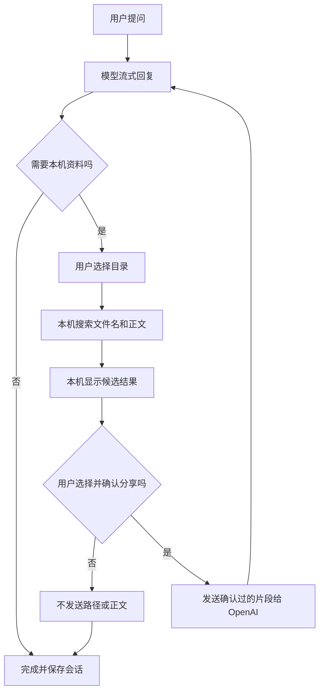

# DeskPilot V1 产品规格与迭代开发指南

> 状态：产品范围已与用户对齐，可作为后续 Codex 实现和迭代的基线。  
> 更新日期：2026-10-14  
> 目标平台：Windows 桌面端

## 1. 给后续 Codex 的执行说明

开始任何一轮实现前，先阅读本文件和仓库内的 `AGENTS.md`、`README.md`、现有架构说明。尊重已有代码和约定，优先完成用户本轮明确要求的最小可交付切片。

本文件记录已确认的产品决定。不得默默扩大权限、增加文件类型、保存额外数据或启用新的模型数据传输。如果实现需要改变下列产品行为，先提出明确问题并等用户决定。技术实现细节可以由 Codex 在符合本规格的前提下自行选取；作出会影响架构、隐私、操作范围或用户体验的选择时，要更新本文件并说明理由。

每轮结束时报告：完成的功能、涉及的关键设计、如何验证、尚未覆盖的验收项。未完成的阶段不得标记为已完成。

## 2. 产品定位

DeskPilot 是一款本机运行的 Windows AI 桌面助手。用户可以进行流式 AI 对话，并在自己选择的目录中本机搜索纯文本和源码。搜索结果先在本机展示；只有用户逐次选择并确认后，应用才会把选中的文件片段发送给 OpenAI，供模型继续回答。

产品要展示可靠的桌面工程能力：Electron 进程边界、窄 IPC、本地文件权限、模型工具调用、任务取消、SQLite 会话记录和资源回收。

## 3. 已确认的产品决定

| 项目 | V1 决定 |
|---|---|
| 平台 | 先做 Windows 桌面版。首版不承诺 macOS 或 Linux。 |
| Agent 能力 | 聊天、用户指定目录的本机搜索、只读文件工具。 |
| 模型 | 接入 OpenAI API；代码中通过 Provider 接口隔离供应商，保留替换空间。 |
| API Key | 用户自行填写。加密后保存在本机 Windows 受保护存储中；不得写进 renderer、日志、源码或普通数据库字段。 |
| 目录授权 | 开始一次新的文件搜索任务时，用户通过系统目录选择器选择目录。不得默默沿用此前任务授权。 |
| 本机搜索 | 用户选择目录后，允许应用在本机只读扫描文件名、纯文本和源码正文。 |
| 发送文件内容 | 搜索结果留在本机显示。每次发送具体片段给 OpenAI 前，都要展示路径和片段并取得用户确认。一次确认授权读取所选片段并发送该片段。 |
| 本机记录 | 使用 SQLite 保存会话、消息、任务和工具记录。经确认发送给模型的片段保留在所属会话中。删除会话时一并删除该会话及其关联记录。 |
| 文件操作 | 只允许搜索和读取。不写入、覆盖、移动或删除用户文件，不执行 Shell 或任意本地命令。 |
| UI 语言 | 默认简体中文。 |

## 4. 目标用户与主要场景

目标用户希望在桌面上向 AI 提问，并在需要时让 AI 参考本机某个工作目录中的代码、日志或文档。他们需要清楚知道：哪些内容在本机被搜索、哪些片段会发给模型、授权后会保存什么，以及如何停止任务或删除会话。

典型场景：用户选择一个项目目录，询问“这个模块的配置加载流程是什么”。DeskPilot 在本机搜索候选文件，把命中位置和短片段列给用户；用户选择要分享的片段并确认；模型收到经批准的内容后生成回答。

## 5. V1 范围

### 5.1 必须实现

- 创建、切换和删除本地会话。
- 输入消息并通过 OpenAI API 获取流式回复。
- 显示发送中、生成中、等待用户确认、已完成、失败和已取消等状态。
- 用户可随时停止当前模型请求或文件搜索任务。
- 用户每次发起文件搜索任务时选择一个目录。
- 在该目录中本机搜索文件名、纯文本和源码正文，并在界面显示候选结果。
- 发送任何文件路径或内容片段给 OpenAI 前，显示将发送的确切内容并取得逐次确认。
- 模型可提出已登记的只读工具调用；应用必须先校验工具名、参数、任务范围和授权状态。
- 使用 SQLite 持久化会话、消息、任务及工具调用状态。
- 设置页允许配置 OpenAI API Key，并提供连接或配置验证反馈。
- 删除会话时删除其消息、任务、工具记录和已获准发送的文件片段。
- 搜索索引或缓存只在当前任务生命周期内使用；不得静默持久化完整文件正文索引。

### 5.2 不属于 V1

- 写文件、删除文件、重命名或移动文件。
- 执行终端命令、脚本、应用安装包或模型返回的代码。
- PDF、Word、Excel、PowerPoint 正文解析。
- 文件上传到云端、向量数据库、云端索引或自动同步。
- 登录账号、多用户协作、云端会话同步。
- 自动使用上一次授权目录，或后台持续扫描用户文件。
- 自动更新、自动执行模型建议或静默权限授予。
- macOS、Linux 和移动端支持。

## 6. 核心用户流程

### 6.1 普通对话

1. 用户打开或创建会话。
2. 用户输入消息并发送。
3. renderer 展示流式回复和任务状态。
4. 用户可以停止请求；停止后 UI、请求和任务记录都转为已取消。
5. 会话与消息写入本机 SQLite。

### 6.2 本机搜索与逐次分享

1. 用户在消息中请求参考本机文件，或模型提出调用 `search_files`。
2. 若本次任务还未选择目录，应用弹出系统目录选择器。
3. 应用仅在用户选定目录中本机搜索文件名、纯文本和源码正文。搜索结果不得自动返回模型。
4. UI 在本机显示候选路径、命中位置和预览片段；用户可以取消、选择零个或多个候选片段。
5. 发送前，确认界面展示将发给 OpenAI 的文件路径和确切片段。不要只显示模糊摘要或字符数。
6. 用户确认后，应用读取所选内容并将确认过的片段随工具结果发送给模型；把该工具结果保存在对应会话中。
7. 用户拒绝或关闭确认界面时，不发送任何文件路径或正文。可向模型返回不含路径和正文的通用拒绝状态，或在 UI 提示用户未分享文件。
8. 任务结束后释放临时搜索结果、文件句柄、计时器、监听器及取消句柄。

> 用户对某次分享的确认只覆盖确认界面中显示的路径与片段，不应授权模型继续读取其他文件。每次新的文件片段分享都重新确认。

### 6.3 流程图



## 7. 文件搜索、隐私与安全要求

### 7.1 文件搜索

- 搜索根目录来自系统目录选择器，不接受 renderer 传入任意文件系统根路径作为授权。
- 仅处理纯文本和源码类文件。具体扩展名清单应在实现前列出并集中配置；扩展名清单属于工程默认值，若要增加 PDF 或 Office 文档需要用户另行确认。
- 排除隐藏项目、`.git`、`node_modules`、构建输出、二进制文件、`.env`、常见私钥和凭据文件。排除规则集中维护并可读。
- 对单文件大小、单次扫描文件数量、并发度、任务时长、命中数、预览长度和发送总长度设置上限。具体数值可以由实现者选择保守初值，并写入配置或常量；它们不能改变“用户确认后才发送”的规则。
- 每条结果都保留任务 ID 和规范化路径；在读取时再次校验路径仍在授权目录内，不能只依赖早先搜索结果。
- 防止 `..` 路径穿越、绝对路径注入、符号链接逃逸、大小写与分隔符差异导致的目录边界绕过。
- 文件名、路径、命中片段和正文不得出现在普通日志、崩溃报告或分析遥测中。若调试需要内容，必须由用户明确开启并提供清除方式；V1 默认不记录。

### 7.2 数据如何流动

- 用户普通问题和对话内容会发送给 OpenAI，以获得模型回复。
- 本机文件搜索查询可能作为对话内容发给模型，但搜索结果、命中文件路径和正文在获准前不得发给 OpenAI。
- 用户确认的片段连同必要路径信息才可以发送给 OpenAI；确认界面必须精确展示发送内容。
- 用户确认分享的内容会作为会话工具记录写入 SQLite。用户删除会话时关联记录一起删除。
- API Key 只用于主进程到 OpenAI 的认证；不得通过 IPC 返回给 renderer，也不得保存到对话或工具记录。

### 7.3 权限边界

- Renderer 是不可信 UI 层，不直接访问 Node.js、文件系统、SQLite、API Key 或原始 Electron IPC。
- Preload 通过 `contextBridge` 暴露窄小、类型化的功能接口，不暴露通用 `send(channel, payload)` 或完整 Electron API。
- 主进程负责校验 IPC sender、验证参数、管理会话、执行授权策略、调用 Provider 和保存数据。
- 本机搜索服务只能处理当前任务明确授权的目录；不能自行弹出目录之外的访问。
- Agent 工具注册表 V1 只包括只读能力，例如 `search_files`、`read_file_excerpt`。没有 `write_file`、`delete_file`、`run_command` 等工具。
- Utility Process 可用来隔离索引或 CPU 密集任务，但它不是自动安全沙箱。输入范围、并发、取消和 IPC 消息仍需在应用中校验。

## 8. 建议的技术架构

实现前先确认仓库既有技术栈。如果是空仓库，建议使用 Electron + TypeScript；前端框架由已有依赖或团队约定决定，不为 V1 引入不必要的多套框架。

```text
Renderer
  └─ 聊天、会话、搜索结果、分享确认、设置
      │ 定向且类型化的 API
Preload
  └─ contextBridge 门面
      │ 经过校验的 IPC
Main Process
  ├─ 会话与任务编排
  ├─ OpenAI Provider 及可替换接口
  ├─ 工具注册表和权限闸门
  ├─ SQLite Repository
  ├─ API Key 加密存取
  └─ Utility Process 管理（需要时）
      │ 有范围、有上限、可取消的任务消息
Utility Process（可选）
  └─ 本机文件遍历、文本解析、索引或 CPU 密集工作
```

### 8.1 Electron 配置基线

- `nodeIntegration: false`
- `contextIsolation: true`
- `sandbox: true`
- 严格 Content Security Policy
- 限制窗口导航、弹出新窗口和外部链接
- 校验所有特权 IPC 的 sender 与参数
- 只暴露具体 API 方法，并为请求、事件、错误和返回值定义 TypeScript 类型
- 主进程、preload 和 renderer 的 DTO 类型集中管理，运行时输入另做校验；`.d.ts` 不能代替运行时检查

### 8.2 建议 API 边界

接口名称可以依仓库风格调整，但职责应保持窄小：

- `sessions.list()`、`sessions.create()`、`sessions.delete(id)`
- `chat.send({ sessionId, message })`、`chat.cancel(requestId)`
- `files.chooseDirectory()`、`files.search({ requestId, query, filters })`
- `files.approveExcerpt({ requestId, resultId, range })`
- `files.rejectExcerpt({ requestId, resultId })`
- `settings.getModelConfig()`、`settings.saveApiKey(key)`、`settings.testConnection()`
- `tasks.onUpdate(callback)`、`tasks.removeListener(callback)`

不得提供接收任意 IPC channel、任意本地路径或任意可执行命令的通用接口。

## 9. 数据与生命周期

### 9.1 SQLite 数据对象

最低限度需要表达：

- Session：会话 ID、标题、创建与更新时间。
- Message：角色、文本、顺序、创建时间、所属会话。
- Task：请求 ID、会话 ID、状态、开始 / 结束时间、取消或错误状态。
- ToolRun：工具名、经验证参数的安全摘要、状态、耗时、结果摘要；经用户批准发送的片段作为对应的工具消息保存在会话中。
- SchemaVersion：数据库迁移版本。

不得将 API Key 存入这些表。不要默认存储完整搜索索引或未批准的候选片段。删除会话要在一个可靠的数据库事务中删除所有关联数据。

### 9.2 状态与取消

任务状态至少包括：`queued`、`running`、`awaiting_user_approval`、`cancelling`、`completed`、`failed`、`cancelled`、`interrupted`。

每个任务使用唯一 request ID 和独立取消上下文。取消要传递到网络请求、SSE 流读取、文件遍历、文本解析、worker 消息和后续 Agent 循环。不要在取消后启动新的工具步骤。任务结束时释放 AbortController、流读取器、worker 监听器、IPC 订阅、计时器和临时缓存。

应用异常退出后，重启时将遗留的 `queued` / `running` / `awaiting_user_approval` 状态转换为 `interrupted`，不得报告为成功。

## 10. 迭代开发阶段与验收门槛

Codex 应按阶段小步实现并保持应用可启动。每轮如用户提出新需求，再据此调整阶段和范围；阶段划分本身不构成扩大产品范围的授权。

### 阶段 0 仓库确认与实现计划

- 阅读 `AGENTS.md`、README、依赖、构建和现有测试约定。
- 检查仓库当前状态，不覆盖已有用户改动。
- 给出短实现计划、依赖选择和文件结构；空仓库才建立脚手架。

**验收：**架构决定与本规格一致；所有需要用户做产品决定的事项单独列出；此阶段不引入额外写文件或命令执行能力。

### 阶段 1 安全桌面骨架

- 启动 Electron + TypeScript 窗口。
- 配置 main / preload / renderer 边界和窄 IPC。
- 实现简体中文基础布局和会话列表占位。

**验收：**renderer 无 Node.js 访问；安全默认值可从配置检查；应用能在 Windows 本地启动。

### 阶段 2 会话与本地存储

- 创建 SQLite schema 和迁移机制。
- 实现会话、消息的创建、读取、删除。
- 实现 API Key 的输入和安全存取。

**验收：**重启后会话仍可读取；删除会话删除关联记录；数据库和日志中无明文 API Key。

### 阶段 3 流式对话与取消

- 建立 Provider 接口并接入 OpenAI API。
- 实现流式文本、错误展示、停止按钮和连接状态。

**验收：**可见增量回复；取消后不再显示后续增量；密钥只在主进程使用；网络断开时任务能进入失败或取消状态。

### 阶段 4 本机只读搜索

- 实现目录选择、限定范围遍历、文件名和文本正文搜索。
- 实现候选结果列表和本地片段预览。
- 加入排除、边界校验、资源限制和任务取消。

**验收：**搜索结果留在本机；路径穿越、符号链接逃逸、隐藏凭据、二进制和越界目录均被阻止或跳过；搜索不会阻塞 UI。

### 阶段 5 Agent 调用与分享确认

- 实现工具 schema、参数校验、工具循环上限。
- 让搜索结果先显示在本地 UI，不自动传给模型。
- 实现精确片段确认、拒绝、取消和确认后的结果回传。

**验收：**确认前网络请求和 SQLite 中都没有候选路径或正文；拒绝后不发送文件内容；确认后只发送对话框中展示的选定范围；确认片段随会话删除。

### 阶段 6 收尾、打包与文档

- 完成任务重启恢复、监听器与临时资源清理、Windows 打包。
- 更新 README、数据流说明、权限说明和演示步骤。

**验收：**Windows 安装包可启动；用户能演示普通对话、搜索、确认分享、拒绝分享、取消任务和删除会话；文档描述与实际行为一致。

## 11. V1 验收清单

### 产品行为

- [ ] 可创建、切换、删除会话。
- [ ] OpenAI 回复增量显示，错误状态清楚，用户能取消。
- [ ] 每个新的文件搜索任务都要求用户选择目录。
- [ ] 文件正文搜索在本机执行，候选结果不自动传给模型。
- [ ] 每次分享都展示确切路径和片段并要求确认。
- [ ] 只读工具可用；写文件、删除和命令执行均不存在或不可达。
- [ ] 会话和任务写入本机 SQLite，删除会话同时删除关联片段与工具结果。

### 隐私与安全

- [ ] API Key 不出现在 renderer、日志、数据库或源码中。
- [ ] 未批准路径与文件正文不会发送到 OpenAI。
- [ ] 目录外路径、路径穿越和符号链接逃逸被拒绝。
- [ ] 限制大文件、超量文件、过长搜索和过长模型上下文。
- [ ] 应用只请求完成功能所需的目录访问。

### 稳定性

- [ ] 连续取消、关闭窗口、断网和 worker 异常都有明确终态。
- [ ] 没有重复 IPC listener、永久计时器或未释放 worker。
- [ ] SQLite 写入失败不会谎报成功，也不会丢失关键状态。
- [ ] 重启后运行中的任务显示为中断。

## 12. 后续允许讨论的实现选项

以下不是已确认的产品决定，开发时可先选保守方案并在 README 或 ADR 记录：

- UI 使用 React、Vue 或仓库已有框架。
- API Key 使用 Electron `safeStorage` 或 Windows 凭据管理器的具体包装方式；必须验证安全存储可用性，无法安全保存时要明确报错，不能退回明文。
- OpenAI 模型名、请求超时、重试规则、每次搜索的上限、预览长度和允许的文本扩展名。
- 本地扫描使用主进程 worker、Utility Process 或合适的受限工作进程。
- Windows 安装包格式、代码签名和更新机制；自动更新不属于 V1。

当实现选项影响用户数据是否离开设备、保存多久、能否修改文件、权限需要多宽或目标平台时，不把它当作普通技术细节处理，先征求用户决定。

## 13. 官方技术参考

- [Electron Security](https://www.electronjs.org/docs/latest/tutorial/security/)
- [Electron Process Model](https://www.electronjs.org/docs/latest/tutorial/process-model)
- [Electron IPC](https://www.electronjs.org/docs/latest/tutorial/ipc)
- [Electron Utility Process](https://www.electronjs.org/docs/latest/api/utility-process)
- [Electron safeStorage](https://www.electronjs.org/docs/latest/api/safe-storage)
- [TypeScript Declaration Files](https://www.typescriptlang.org/docs/handbook/declaration-files/introduction.html)
- [OpenAI Responses Streaming](https://platform.openai.com/docs/api-reference/responses-streaming)
- [OpenAI Function Calling](https://platform.openai.com/docs/guides/function-calling)
- [SQLite Write-Ahead Logging](https://www.sqlite.org/wal.html)

