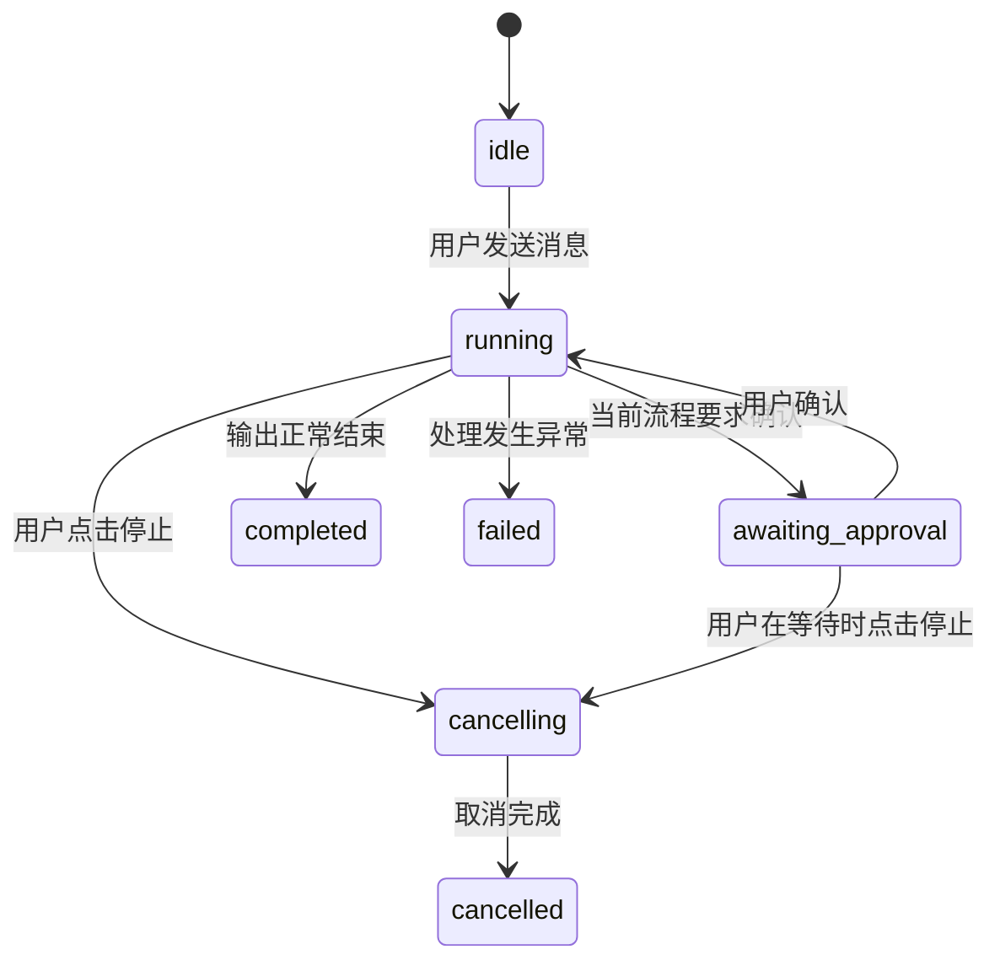

# 第 2 周：界面状态与 IPC 流程构建过程

这份文档记录 DeskPilot 第 2 周功能是怎样一步步接入项目的。它从开发者实施任务的视角说明每一步先看什么、为什么这么做、改了哪些文件，以及怎样确认结果。

## 目标与起点

第 2 周的目标是让一个桌面会话拥有清楚、可见、可取消的任务流程：用户发送后能看到生成中和增量输出；需要确认时能停在等待状态；用户停止或关闭窗口后，界面不再显示任务仍在运行；快速操作和迟到消息不能串到别的请求。

开始时先检查项目，而不是直接套用一个新模板。仓库是一个很小的 Electron CommonJS 示例：只有打开文件对话框按钮，没有聊天 UI、任务状态、会话模型、前端框架或 TypeScript 配置。规格文件也明确要求 renderer 不直接访问 Electron IPC，并要求任务事件有唯一请求标识、状态和取消处理。

因此，本轮选择沿用现有 Electron 项目和原生 HTML/CSS/JavaScript，不额外引入 React 或 Vue；只增加 TypeScript 编译器，用来检查共享 IPC 类型声明和 preload 门面。真实模型、文件访问和数据持久化不属于本周 UI/IPC 演练的实现内容。

## 第一步：先把“任务”画成状态迁移

在编写按钮之前，先确定用户操作对应的状态变化，避免 UI 各自维护一套互相矛盾的状态：



实现时把 `completed`、`failed`、`cancelled` 当作终态：进入终态后，不再让后续事件改写状态或追加回复。窗口关闭时，主进程取消窗口所属的活动任务；窗口销毁后不再向它发送 UI 更新。

状态定义和面向用户的完整状态图也分别保存在 [ipc.d.ts](E:/WorkSpace/ElectronDemo/DeskPilot/ipc.d.ts) 和 [第2周-状态迁移图.md](E:/WorkSpace/ElectronDemo/DeskPilot/第2周-状态迁移图.md) 中。

## 第二步：先约定跨进程消息长什么样

任务不是 renderer 自己“猜测”什么时候完成，而是主进程通过事件逐步通知 renderer。先为所有任务事件统一外层结构：

```text
requestId       这一次发送的唯一标识
conversationId  这次发送属于哪个会话
eventType       状态、回复片段或授权事件
sequence        同一请求内递增的事件序号
timestamp       主进程发出事件的时间
payload         与事件类型对应的数据
```

接着用 TypeScript discriminated union 把“事件种类”和“payload 形状”绑定起来：`task.state` 只能携带状态信息，`task.delta` 携带文本片段，`task.approval` 携带授权提示或确认结果。这样后续新增事件时，类型检查可以指出事件名和数据不匹配的问题。

对应文件是 [ipc.d.ts](E:/WorkSpace/ElectronDemo/DeskPilot/ipc.d.ts)。[tsconfig.json](E:/WorkSpace/ElectronDemo/DeskPilot/tsconfig.json) 将这份声明与 preload 实现纳入类型检查；[electron-shims.d.ts](E:/WorkSpace/ElectronDemo/DeskPilot/electron-shims.d.ts) 为当前 Electron 子路径提供编译器需要的声明。

## 第三步：先建立安全的窗口和主进程任务入口

主进程负责决定一个请求何时开始、等待、取消和结束。实现顺序如下：

1. 配置 BrowserWindow 的 `nodeIntegration: false`、`contextIsolation: true`、`sandbox: true`，确保 renderer 不直接拿到 Node 能力。
2. 屏蔽新窗口和页面导航，保持 UI 留在本应用界面。
3. 为调用 IPC 的 renderer 校验 sender，拒绝没有关联到本应用窗口的请求。
4. 收到 `chat:send` 后检查会话 ID、消息类型、空消息和长度，再生成 `requestId` 并创建任务记录。
5. 任务状态只由主进程更新；每次发送任务事件时递增该任务的 `sequence`。

这些处理集中在 [main.js](E:/WorkSpace/ElectronDemo/DeskPilot/main.js)。为了让本周界面能够演练流式和授权状态，主进程暂时生成分段的本地演示回复；含“搜索本机”“读取文件”或 `[授权]` 的消息会先进入 `awaiting_approval`。这里的确认只演练状态，不执行文件读取，也不访问模型。

## 第四步：用窄 preload API 把必要操作交给界面

renderer 不应该接收任意 channel 并自行调用 IPC，因此 preload 只开放四项具体能力：

- `send`：提交会话 ID 和消息文本。
- `cancel`：取消指定的 `requestId`。
- `approve`：确认指定的等待中请求。
- `onTaskEvent`：订阅任务事件，并返回一个可用于解除订阅的函数。

实际接口在 [preload.js](E:/WorkSpace/ElectronDemo/DeskPilot/preload.js)。接口对象使用共享的 `DeskPilotAPI` 类型约束，使 renderer 可调用的方法与事件回调签名保持一致。

## 第五步：搭出聊天界面，再把状态放进界面

先把最小聊天区域按用户能辨认的结构搭好：左侧会话列表、顶部当前会话标题、中间消息区域、底部输入框，以及生成任务时显示的状态横幅。相关文件是 [index.html](E:/WorkSpace/ElectronDemo/DeskPilot/index.html) 和 [styles.css](E:/WorkSpace/ElectronDemo/DeskPilot/styles.css)。

随后在 [renderer.js](E:/WorkSpace/ElectronDemo/DeskPilot/renderer.js) 接上交互：

1. 新建会话时分配 `conversationId`，并显示空会话欢迎内容。
2. 用户发送后立即把用户消息和一条待填充的助手消息放进当前会话。
3. 调用 preload 的 `send`，获得主进程返回的 `requestId`。
4. 收到 `task.state` 时更新状态横幅；收到 `task.delta` 时只向对应会话的助手消息追加文本。
5. 在 `running` 状态显示停止按钮；在 `awaiting_approval` 状态显示确认按钮。
6. 用户切换侧栏会话时，渲染该会话自己的消息和最近任务状态。

发送按钮会在请求提交过程中禁用，发送函数也会再次检查当前会话是否有活动任务。这让快速双击不至于为同一会话重复提交。每个任务仍单独按 `requestId` 记录，因此换会话时旧请求的事件不会追加到新会话。

## 第六步：补上取消、迟到事件和窗口关闭处理

仅仅把按钮文字改成“已停止”还不够；主进程必须停止后续工作，renderer 也必须拒绝迟到的文本：

1. 用户点击停止，renderer 按当前任务的 `requestId` 调用 `cancel`。
2. 主进程先发出 `cancelling`，设置取消标记并唤醒等待中的演示任务，然后发出 `cancelled`。
3. 演示任务每次准备发送新片段前检查取消标记；被取消后直接结束。
4. renderer 记录每个 `requestId` 最近处理的序号，只接受更大的 `sequence`，从而忽略重复或过期事件。
5. renderer 对已完成、失败或取消的任务不再追加文本。
6. 窗口关闭时，主进程把该窗口名下的活动任务设为取消，并清理窗口关联；销毁的 renderer 不再收到后续事件。

这几层防护分别覆盖“主进程停止产生新内容”“界面拒绝旧内容”和“关闭窗口后解除任务到窗口的关联”，而不是只依赖按钮外观。

## 第七步：遇到配置和事件时序问题后修正

实现过程中，类型检查暴露了 TypeScript 当前版本不再接受旧的 `node10` 模块解析设置，于是把配置改为 `Node16`。Electron 的 `electron/renderer` 子路径类型在当前项目设置中无法自动解析，因此添加了范围很小的 `electron-shims.d.ts`，再对 preload 门面进行严格类型检查。

另外，主进程可能在 `send()` 的 Promise 返回 renderer 前就发出第一个任务事件。renderer 因此会先创建临时任务记录；拿到真正的 `requestId` 后，将临时助手消息关联到已收到事件的任务，保留已经处理的序号和状态。这个处理防止“第一个 running 事件到得早，后续事件却从序号 1 重新开始”的错序问题。

## 第八步：检查实现结果

最后运行以下检查：

```powershell
npm run typecheck
node --check main.js
node --check preload.js
node --check renderer.js
```

以上 TypeScript 检查和三个 JavaScript 文件的语法检查均通过。本轮没有运行 Electron 窗口的手工视觉验收，也没有接入真实模型或实际文件授权；因此“应用运行时的窗口视觉效果”尚未由这组命令验证。

## 最终文件分工

| 文件 | 在构建过程中的职责 |
| --- | --- |
| `index.html` | 会话、消息、输入和任务横幅的结构 |
| `styles.css` | 聊天工作区和任务状态的视觉样式 |
| `renderer.js` | 会话 UI、发送交互、事件顺序过滤和状态展示 |
| `preload.js` | 对 renderer 暴露的窄 IPC API |
| `main.js` | sender 校验、请求创建、状态迁移、事件序号、取消与窗口生命周期 |
| `ipc.d.ts` | 请求、任务事件和 API 的 discriminated union 类型 |
| `electron-shims.d.ts` | TypeScript 检查所需的 Electron 子路径类型声明 |
| `tsconfig.json` | IPC 声明和 preload 门面的严格类型检查配置 |
| `第2周-状态迁移图.md` | 面向使用者的操作流程和可见状态说明 |

## 本周交付边界

已完成会话侧栏、消息列表、输入框、停止按钮、流式输出演示、等待授权状态、任务完成/失败/取消状态、窄 IPC 门面、事件类型约束、序号过滤和窗口关闭取消。当前会话数据只存在内存中；回复来自本地演示逻辑；授权按钮不会访问文件。SQLite、真实 Provider、文件搜索和重启后的任务恢复仍需在后续阶段实现。
