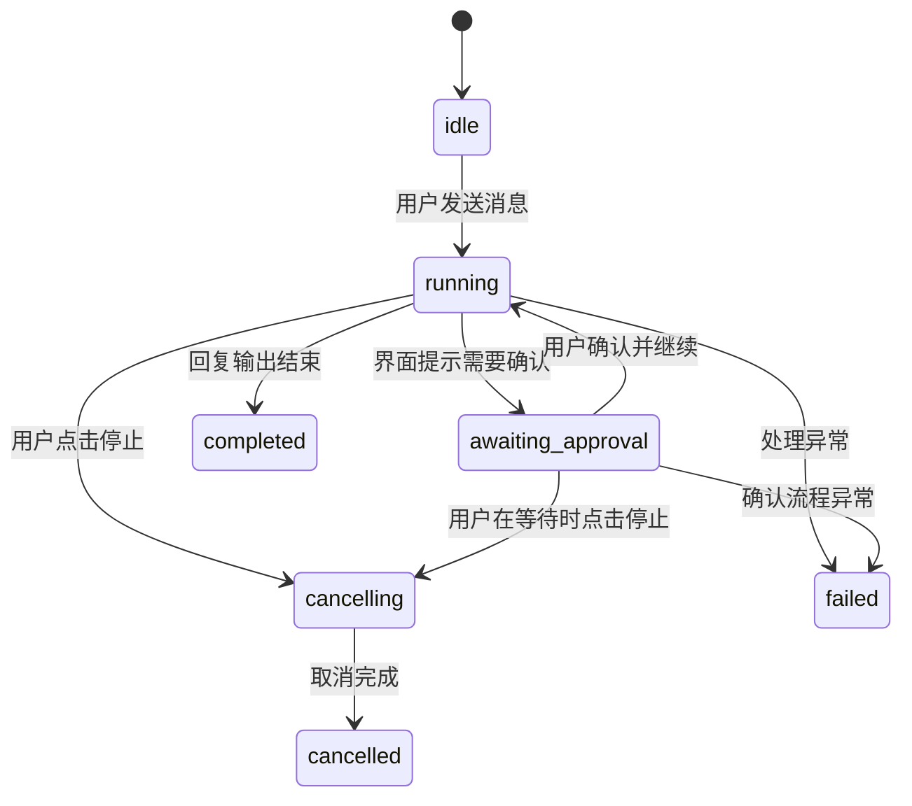

# 第 2 周：从用户操作看会话状态与 IPC

本周交付的是可操作的聊天界面和任务生命周期演示。下面按用户使用 DeskPilot 的顺序说明每一步会看到什么、可以做什么，以及应用内部如何保证状态一致。

## 1. 打开应用：空会话

1. 用户启动 DeskPilot。
2. 左侧显示会话列表和“新建会话”，中间显示欢迎说明和示例问题，底部显示消息输入框。
3. 用户可以点击示例问题，也可以直接输入；点击“新建会话”会在侧栏创建一条新会话并切换过去。

此时没有活动任务，输入框可用。会话目前只保存在当前应用进程的内存中，尚未实现重启后的历史记录。

## 2. 发送消息：生成中与流式输出

1. 用户输入消息，按 Enter 或点击发送按钮。Shift + Enter 会在输入框中换行。
2. 消息立即显示在当前会话中，输入框清空；同一会话的发送按钮暂时不可再次提交，避免快速连点创建互相混淆的请求。
3. 界面显示“正在生成回复…”，助手回复逐段出现。
4. 输出结束后，状态显示“已完成”，用户可以继续发送下一条消息，或切换其他会话。

每次发送会产生唯一 `requestId`，并关联当前 `conversationId`。即使用户切换会话，返回内容仍会写入原会话对应的消息位置。

## 3. 等待确认：授权提示与继续

1. 用户发送包含“搜索本机”“读取文件”或 `[授权]` 的消息。
2. 界面切换为“等待你的授权”，显示说明和“确认并继续”按钮；任务此时暂停，不继续生成回复。
3. 用户点击“确认并继续”，界面短暂显示“授权已确认，正在继续”，随后恢复流式输出并最终完成。

本周的确认流程只用于演示状态变化，不会真正搜索目录、读取文件或把内容发送给模型。实际文件授权流程应在后续接入受限的文件能力时再实现。

## 4. 停止任务：取消中的状态与终态

1. 用户在回复生成时点击“停止”。
2. 界面先显示“正在停止…”，主进程接收该请求的取消指令。
3. 取消完成后显示“已停止”；之后迟到的回复片段不会再追加到消息中。
4. 用户可以再次发送消息，或切换会话。

等待授权时也可以停止。状态会从 `awaiting_approval` 进入 `cancelling`，再到 `cancelled`。取消按钮只针对当前请求，不会影响其他会话的任务。

## 5. 失败与重新操作

如果主进程处理请求时发生异常，界面显示“任务失败”和错误说明。失败是终态；用户可以再次发送消息以发起一个新的 request，而不是复用已失败的请求。

当前演示回复由本地代码生成，正常情况下不会触发真实模型或网络故障。真实 Provider 接入后，需要将网络错误映射到同一 `failed` 状态。

## 6. 切换会话与关闭窗口

- 用户点击侧栏中的其他会话时，消息列表和任务状态横幅会切换到该会话；原任务的后续事件仍归属原会话。
- 用户创建新会话时，旧会话不会被清空，任务事件也不会串到新会话。
- 用户关闭窗口时，主进程会取消该窗口仍在运行或等待授权的任务。窗口销毁后不再投递 UI 事件，因此不会留下持续显示“运行中”的窗口。

## 状态迁移图

`completed`、`failed` 和 `cancelled` 是终态，不接受后续状态覆盖。关闭窗口会取消活动任务；窗口销毁后停止向它发送事件。

## IPC 如何对应用户看到的变化

所有任务事件都带有 `requestId`、`conversationId`、`eventType`、`sequence`、`timestamp` 和对应的 `payload`。`ipc.d.ts` 使用 TypeScript discriminated union 描述可接受的事件：

| 事件类型 | 界面效果 |
| --- | --- |
| `task.state` | 更新“生成中”“等待授权”“已完成”“已停止”或“失败”等状态 |
| `task.delta` | 将新的回复片段追加到对应会话的助手消息 |
| `task.approval` | 显示确认提示，或记录用户确认已处理 |

主进程为同一个 request 按顺序递增 `sequence`。renderer 为每个 `requestId` 单独记录已处理序号，重复或过期事件会被忽略；终态之后到达的回复片段也不会显示。这样用户快速操作、切换会话或停止任务时，不会把一个请求的状态和内容混入另一个请求。

## 本周实现范围

已实现会话侧栏、消息列表、输入框、流式演示输出、等待确认、停止按钮、任务状态横幅和窗口关闭时取消。回复与确认均为本地演示；真实模型、文件搜索、持久化会话和跨重启任务恢复尚未接入。
